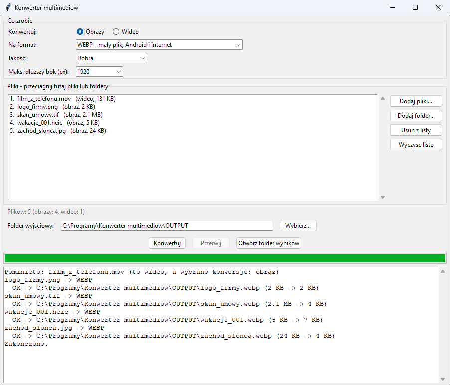

# Konwerter multimediów

Program **lokalny** do zamiany zdjęć, grafik i filmów na formaty, które
działają na Windowsie i na telefonach z Androidem. Wszystko dzieje się na
Twoim komputerze: pliki nie są nigdzie wysyłane, więc można go używać do
dokumentów i zdjęć z danymi osobowymi (zamiast serwisów „konwertuj online”).



## Co potrafi

**Obrazy** → wybierasz jeden format wyjściowy:

| Format | Do czego |
|--------|----------|
| **JPG** | zdjęcia, najpowszechniejszy; przezroczystość zastępowana białym tłem |
| **PNG** | grafiki i zrzuty ekranu, bez strat, z przezroczystością |
| **WEBP** | mały plik, dobry na Androida i do internetu |
| **BMP** | bez kompresji (stare programy) |
| **TIFF** | skany i druk (kompresja LZW) |
| **GIF** | 256 kolorów |
| **ICO** | ikona Windows (wiele rozmiarów do 256 px, obraz wstawiany na kwadrat) |

Wejście: JPG, PNG, BMP, TIFF, WEBP, GIF, ICO oraz **HEIC/HEIF i AVIF**
(zdjęcia z nowszych telefonów, które Windows często nie otwiera).

**Wideo** → wybierasz jeden format wyjściowy:

| Format | Zawartość | Do czego |
|--------|-----------|----------|
| **MP4** | H.264 + AAC | najbardziej uniwersalny: Windows, Android, iPhone, telewizory, WhatsApp |
| **WEBM** | VP9 + Opus | internet, mniejszy plik, ale kodowanie jest wolniejsze |
| **MKV** | H.264 + AAC | kontener bez ograniczeń rozmiaru i funkcji |
| **AVI** | MPEG-4 + MP3 | starsze odtwarzacze i urządzenia |
| **GIF** | animacja bez dźwięku | krótkie fragmenty (12 klatek/s, domyślnie do 480 px wysokości) |
| **MP3** | sam dźwięk | wyciągnięcie ścieżki audio z filmu |

Wejście: MP4, M4V, MKV, AVI, MOV, WMV, WEBM, FLV, 3GP, MPG, TS, MTS, M2TS
oraz animowany GIF (zamiana na MP4 zmniejsza go zwykle kilkadziesiąt razy).

**Opcje wspólne:**
- **Jakość**: Wysoka / Dobra (domyślna) / Mała (mały plik). Dotyczy JPG, WEBP i wideo.
- **Maksymalny rozmiar**: dłuższy bok (obrazy) albo wysokość (wideo) w pikselach.
  Mniejsze obrazy i filmy nie są powiększane.
- Obrazy są **obracane zgodnie z EXIF** (zdjęcie z telefonu trzymanego pionowo
  zostaje pionowe), a **reszta metadanych, w tym lokalizacja GPS, nie jest
  kopiowana** do wyniku.
- Wynik zawsze trafia do **osobnego folderu** (domyślnie `OUTPUT`). Istniejący
  plik nie zostanie nadpisany: dostaje końcówkę `_2`, `_3`…
- Przycisk **Przerwij** zatrzymuje konwersję (niedokończony plik jest usuwany),
  a pasek pokazuje postęp całej listy i pojedynczego filmu.

## Instalacja (jednorazowo)

1. **Python** — pobierz z [python.org](https://www.python.org/downloads/windows/)
   (wersja 3.11 lub nowsza, najlepiej najnowsza). W instalatorze zaznacz **„Add python.exe to PATH”**.
   Opcja „tcl/tk and IDLE” jest zaznaczona domyślnie i musi taka zostać.
   Uprawnienia administratora nie są potrzebne.
2. **Program** — na stronie [github.com/DawidBochno/Konwerter-multimediow](https://github.com/DawidBochno/Konwerter-multimediow)
   kliknij zielony przycisk **Code → Download ZIP**. Rozpakuj archiwum,
   np. do `C:\Programy\Konwerter multimediow`. Nie uruchamiaj programu z wnętrza ZIP-a.
3. Kliknij dwukrotnie **`install.bat`**. Instaluje biblioteki `Pillow`, `pillow-heif`,
   `imageio-ffmpeg` (zawiera program **ffmpeg**, ok. 30 MB do pobrania) i `tkinterdnd2`
   (potrzebny internet) i uruchamia test. Na końcu pojawia się **„selftest OK”**.
   Jeśli Windows pokaże „System Windows ochronił ten komputer”, kliknij
   **Więcej informacji → Uruchom mimo to**.
4. Program uruchamia się plikiem **`uruchom.bat`**. Wygodnie jest zrobić
   skrót na pulpicie: prawy przycisk na `uruchom.bat` → **Wyślij do →
   Pulpit (utwórz skrót)**.

## Jak używać

1. Uruchom `uruchom.bat`.
2. **Pliki** — przeciągnij pliki lub foldery z Eksploratora na listę albo użyj
   **Dodaj pliki…** / **Dodaj folder…**. Pliki leżące w folderze `INPUT` są na
   liście od razu po uruchomieniu. Dwuklik otwiera plik, Delete usuwa go z listy
   (nie z dysku).
3. **Konwertuj**: Obrazy albo Wideo, potem **Na format**, **Jakość** i ewentualnie
   **maksymalny rozmiar**. Gdy na liście są same filmy, program sam przełącza się na Wideo.
4. Kliknij **Konwertuj**. Pliki innego rodzaju niż wybrany (np. film przy
   konwersji obrazów) są pomijane i log o tym informuje. Wyniki trafiają do
   folderu wyjściowego, a oryginały zostają bez zmian. **Otwórz folder wyników**
   pokazuje je w Eksploratorze.

Program zapamiętuje ostatni wybór (rodzaj, format, jakość, rozmiar, folder
wyjściowy i rozmiar okna) w pliku `ustawienia.json` w folderze programu.

### Przykłady

- **Zdjęcia z telefonu iPhone/Samsung (HEIC) do wysłania mailem**: Obrazy → JPG →
  maks. 1920 px.
- **Film z telefonu za duży do wysłania**: Wideo → MP4 → jakość Mała → maks. 720 px.
- **Film, którego nie odtwarza stary telewizor lub komputer**: Wideo → MP4 albo AVI.
- **Ścieżka dźwiękowa z nagrania spotkania**: Wideo → MP3.
- **Logo na ikonę programu**: Obrazy → ICO.
- **Ciężki animowany GIF do maila lub komunikatora**: Wideo → MP4.

## Aktualizacje

Po uruchomieniu program sprawdza w tle na GitHubie, czy jest nowa wersja.
Jeśli jest, pyta **„Pobrać i zainstalować teraz?”**. Pobierane są tylko
zmienione pliki programu. Foldery `INPUT`, `OUTPUT`, ustawienia i pliki
w `przyklad/` nie są nadpisywane. Po aktualizacji zamknij i uruchom program ponownie. Jeśli program
o to poprosi, uruchom też raz `install.bat` (zmieniły się biblioteki).

- Do GitHuba trafia tylko zapytanie o listę plików programu, **nigdy
  dokumenty ani dane**.
- Bez internetu albo przy blokadzie (np. UTM) program działa normalnie,
  bez żadnego komunikatu.
- **Wyłączenie** (np. gdy programy aktualizuje dział IT): utwórz w folderze
  programu pusty plik o nazwie `NIE_AKTUALIZUJ`.
- Kopię pobraną przez `git clone` aktualizuje się poleceniem `git pull`.

## Ograniczenia

- Każdy film ma wynik z **jedną ścieżką wideo i jedną audio** (pierwszą).
  Dodatkowe ścieżki dźwiękowe, napisy i rozdziały nie są przenoszone.
- Filmy HDR (zwykle z nowszych telefonów) po zamianie na MP4 mogą mieć
  wyblakłe kolory, bo program nie przelicza zakresu barw HDR na SDR.
- Zamiana na GIF robi duże pliki, więc używaj jej do kilkusekundowych fragmentów.
- Konwersja stratna (JPG, WEBP, MP4…) za każdym razem odrobinę pogarsza
  jakość. Zachowaj oryginały, a do dalszej obróbki używaj PNG albo TIFF.
- Animowane GIF i WEBP przy konwersji **na obraz** zapisują tylko pierwszą
  klatkę. Do animacji wybierz Wideo.
- Obrazy 16-bitowe (np. TIFF ze skanerów i aparatów naukowych) są
  przeskalowywane do 8 bitów na kanał, a zmiennoprzecinkowe nie są obsługiwane.
- RAW z aparatów (CR2, NEF, ARW…) i HEIC jako format **wyjściowy** nie są obsługiwane.
- Zamiana zdjęć na PDF: użyj programu [Narzędzia PDF](https://github.com/DawidBochno/Narzedzia-PDF).

## Testy

```bash
python konwerter.py --selftest
```

Test sprawdza każdy format wyjściowy obrazów (także przezroczystość na białym tle,
obrót z EXIF, ograniczenie rozmiaru, HEIC, animowany GIF, uszkodzone pliki) i
każdy format wideo na prawdziwym, wygenerowanym filmie (kodeki w wyniku, zmiana
wysokości, postęp, przerwanie, polskie znaki w nazwach). `--selftest --gui`
dodatkowo otwiera okno i zamyka je po 200 ms. CI na GitHubie robi to samo na
Pythonie 3.11 i 3.13.

## Licencje używanych bibliotek

Program korzysta z [Pillow](https://python-pillow.org/) (HPND),
[pillow-heif](https://github.com/bigcat88/pillow_heif) (BSD) i
[imageio-ffmpeg](https://github.com/imageio/imageio-ffmpeg) (BSD), które pobiera
gotowy program [ffmpeg](https://ffmpeg.org/) (GPL, z kodekami x264, libvpx, LAME,
Opus). ffmpeg jest instalowany przez `pip` na Twoim komputerze, a nie rozprowadzany
w tym repozytorium.

## Pomysły na rozwój

**Wideo**
- **Kompresja do zadanego rozmiaru** (np. „zmieść w 25 MB na maila / komunikator”):
  obliczenie bitrate z długości filmu i kodowanie dwuprzebiegowe.
- **Przycinanie** (od–do), obrót i odbicie, zmiana liczby klatek, wypalanie napisów.
- **H.265 (HEVC) i AV1** jako mniejsze pliki. Wymagają jednak odtwarzacza z tym
  kodekiem (na Windows często płatny dodatek), więc dobrze jako opcja „mniejszy plik,
  nowszy sprzęt”.
- **Przyspieszenie sprzętowe** (NVENC, Quick Sync, AMF) dla kilkakrotnie
  szybszej konwersji na komputerach z odpowiednią kartą.
- **HDR → SDR** (przeliczenie barw), żeby filmy z telefonów nie były wyblakłe.
- **Wideo → klatki** (zapis co N sekund jako JPG/PNG) i wybór ścieżki audio/napisów.

**Obrazy**
- **Zachowanie EXIF** (data, aparat) jako opcja; osobno „usuń GPS”.
- **HEIC/AVIF jako format wyjściowy**, wsparcie dla **RAW** (biblioteka `rawpy`),
  wielostronicowe TIFF, animowane WEBP/GIF na wyjściu.
- Znak wodny, obrót, kadrowanie do proporcji (np. 16:9, 1:1, 4:5), tło zamiast przezroczystości.

**Audio** — ten sam silnik obsłuży **MP3, M4A, FLAC, OGG, WAV, Opus** (konwersja
między nimi, normalizacja głośności).

**Wygoda**
- **Gotowe profile**: „Android (zgodność)”, „E-mail”, „WhatsApp”, „Instagram”, „YouTube” oraz
  własne, zapisywane pod nazwą.
- **Podgląd** miniatury i szacowany rozmiar wyniku przed konwersją, porównanie przed/po.
- **Wiele konwersji naraz** (równolegle na kilku rdzeniach) i kolejka z priorytetem.
- Podfoldery z zachowaniem struktury, „zapisz obok oryginału”, **przeniesienie oryginałów
  do Kosza** po udanej konwersji.
- **Menu kontekstowe Eksploratora** („Konwertuj na…”) i tryb wiersza poleceń do skryptów.
- **Wersja `.exe`** (PyInstaller) dla osób bez Pythona, na pendrive.
- Wersje językowe (angielska).
